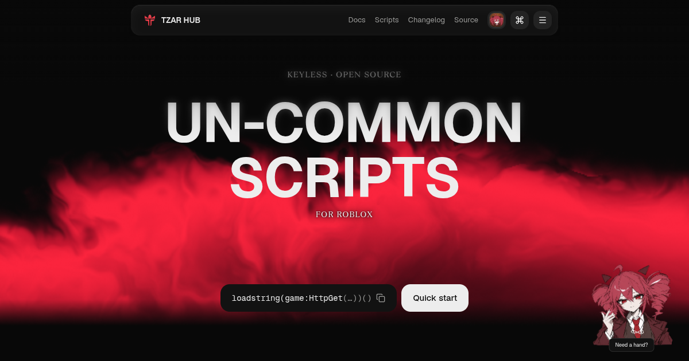

<div align="center">


# TZAR Hub

**Un-common scripts for Roblox. Free, keyless and open source.**

[](https://github.com/2md55nmxkw-arch/tzar-hub/actions/workflows/ci.yml)
[](LICENSE)
[](https://hub.2md.space)
[](https://discord.gg/As2QHxxVjU)

[Website](https://hub.2md.space) · [Quick start](https://hub.2md.space/docs/quick-start) · [Cmdr Panel](https://hub.2md.space/docs/cmdr-panel) · [Changelog](https://hub.2md.space/changelog) · [Source viewer](https://hub.2md.space/source)



</div>

---

TZAR Hub is a Roblox script hub with no keys, no checkpoints, no ads and no accounts. Copy one line into your executor and the script runs. Everything it runs is in this repository and can be read on the site, file by file.

This repository holds the **website** ([hub.2md.space](https://hub.2md.space)) and the **Cmdr Panel**, the hub's in-game command panel.

> [!WARNING]
> **The Cmdr Panel is in development.** It works, but commands, keys, saved data and the game-module format can still change between updates, and some things may break. If you need something stable today, use Avatar Changer. Please report bugs in the [Discord](https://discord.gg/As2QHxxVjU).

## Contents

- [What's inside](#whats-inside)
- [Use it](#use-it)
- [Repository layout](#repository-layout)
- [Develop the website](#develop-the-website)
- [Develop the Cmdr Panel](#develop-the-cmdr-panel)
- [How the site works](#how-the-site-works)
- [Deployment](#deployment)
- [Contributing](#contributing)
- [Security](#security)
- [License](#license)
- [Credits](#credits)
- [Disclaimer](#disclaimer)

## What's inside

| Part | Where | What it is |
| --- | --- | --- |
| **Website** | `src/`, `public/` | React 19 + TypeScript + Vite 8 + Tailwind CSS 4. Landing page, docs, changelog and an in-browser source viewer. Static, with no backend. |
| **Avatar Changer** | `public/avatar-changer.lua` | Wear any player's avatar by username or any look from the Roblox catalog. R6 and R15, game rules, saved outfits and a custom emote wheel. Visual only: only you see it. |
| **Cmdr Panel** (TZAR Admin) | `admin/` → `public/tzar-admin.lua` | A command bar on <kbd>;</kbd>, key binds, a dock, panels and game modules. Strict Luau, bundled with Lune and darklua. *In development.* |

## Use it

Paste a loader into your executor and run it in any Roblox game. Avatar Changer is built and tested on **Potassium**. Other executors should work if they offer the same functions; see [Executors](https://hub.2md.space/docs/executors).

**Avatar Changer**

```lua
loadstring(game:HttpGet("https://hub.2md.space/avatar-changer.lua"))()
```

**Cmdr Panel** *(in development)*

```lua
loadstring(game:HttpGet("https://hub.2md.space/tzar-admin.lua"))()
```

In the Cmdr Panel, press <kbd>;</kbd> to open the command bar and <kbd>RightShift</kbd> to hide everything TZAR draws. `help` lists every command, and the [full list](https://hub.2md.space/docs/cmdr-panel) is on the site.

The loaders always fetch the latest build from this site. What they fetch is exactly the files in `public/`, which you can read on the [Source page](https://hub.2md.space/source).

## Repository layout

```
.
├── admin/                    Cmdr Panel source (Luau): see admin/README.md
├── public/
│   ├── avatar-changer.lua    Avatar Changer, as the loader runs it
│   ├── tzar-admin.lua        Cmdr Panel bundle, built from admin/ (committed)
│   ├── tzar-admin-commands.json  every command, generated by the admin build
│   ├── tzar-assets/          icons, fonts and Teto art the panel downloads in game
│   ├── tzar/                 site art: logo, mascot, game images, illustrations
│   ├── og.png                social preview
│   └── _redirects, robots.txt, sitemap.xml
├── src/
│   ├── App.tsx               routes and redirects
│   ├── components/
│   │   ├── landing/          home page sections, nav, footer, Teto, changelog
│   │   ├── docs/             docs pages (quick start, Cmdr Panel, modules, FAQ, legal)
│   │   ├── source/           the /source code viewer
│   │   └── ui/               shared UI (button, dialog, code block, ...)
│   ├── hooks/, lib/          theme, motion, highlighting helpers
│   └── index.css             theme tokens and global styles
├── scripts/                  Playwright checks used by CI
├── .github/                  CI workflow, issue and PR templates
├── LICENSE                   MIT
└── NOTICE.md                 what MIT does not cover (logos, Teto, fonts, ...)
```

## Develop the website

You need **Node.js 22 or newer** and npm.

```sh
npm ci            # install
npm run dev       # dev server on http://localhost:5173
npm run build     # type-check and build to dist/
npm run preview   # serve dist/ locally
```

| Script | What it does |
| --- | --- |
| `npm run lint` | oxlint over `src`, `scripts` and the Vite config |
| `npm run format` / `format:check` | oxfmt (config in `.oxfmtrc.json`) |
| `npm run check:site` | Playwright check of the site at 320–1440 px: layout, loader copy, menu, palette, routes, redirects, light theme, reduced motion. Set `AUDIT_URL` to point it at another server. Screenshots go to `audit-output/site/`. |
| `npm run check:theme` | Playwright check of the dark/light theme transition |

The checks need Playwright's Chromium: `npx playwright install chromium`.

CI (`.github/workflows/ci.yml`) runs build → lint → format check → `check:site` against `vite preview`, and uploads `audit-output/` when it fails.

## Develop the Cmdr Panel

The panel lives in `admin/` and has its own guide: **[admin/README.md](admin/README.md)**. In short:

```sh
cd admin
rokit install               # pinned lune, darklua, stylua, selene, luau-lsp
lune run build              # writes ../public/tzar-admin.lua and ../public/tzar-admin-commands.json
lune run build -- --check   # what CI runs: fails if the committed bundle is out of date
```

Rebuild and commit `public/tzar-admin.lua` and `public/tzar-admin-commands.json` together with any change under `admin/src/`. CI also runs StyLua, selene, strict luau-lsp and the unit tests.

**Game modules** add features for one game. How they are built is in [admin/docs/modules.md](admin/docs/modules.md). Modules from outside authors are reviewed and published by the TZAR owner only; send yours through the Discord.

## How the site works

| Route | Page |
| --- | --- |
| `/` | Home: hero, Cmdr Panel, changelog, executors, "Free to use. Open to read.", community |
| `/docs`, `/docs/*` | Quick start, Avatar Changer, Cmdr Panel, Game modules, Executors, FAQ, Privacy, Terms |
| `/changelog` | Full changelog (`src/components/landing/changelog-data.ts`) |
| `/source` | Loaders, published files and every Cmdr Panel source file, with highlighting, search, copy and download |
| `/components`, `/v1/:slug` | Script catalog and script pages |
| `/key`, `/user`, `/login`, `/purchase`, `/pricing` | Retired. They redirect to the quick start or the home page. |

Some details worth knowing:

- **Content** shared across pages (site URL, loaders, Discord) lives in `src/components/landing/tzar-content.ts`. The script catalog is in `components-data.ts`.
- **The Cmdr Panel command list** on `/docs/cmdr-panel` is read at runtime from `public/tzar-admin-commands.json`, so the docs always match the build.
- **The source viewer** reads `admin/` at build time with `import.meta.glob` (`?raw`, one lazy chunk per file). It leaves out the build output, the generated Roblox API definitions and `check.ps1`.
- **Syntax highlighting** is a fine-grained Shiki bundle (`src/lib/highlighter.tsx`) with languages loaded on demand, so it stays out of the main bundle.
- **Tailwind** is imported with `source(none)`, so every folder that contains classes must be listed with `@source` in `src/index.css`. A new top-level folder under `src/components/` needs its own line.
- **Type** is Medeo (`medeo-font`): Sans for text and headings, Mono for code, Serif for the small spaced labels. The palette is the red TZAR theme in `src/index.css`.
- **Motion** respects `prefers-reduced-motion`, and the footer has a "Pause animations" switch (WCAG 2.2.2).

## Deployment

The site runs on **Vercel** as a static single-page app:

- `vercel.json` redirects the retired routes and rewrites every other path to `index.html`, so deep links like `/docs/faq` answer 200.
- `public/_redirects` does the same for Netlify and Cloudflare Pages.
- The build copies `dist/index.html` to `dist/404.html` for hosts that use that convention, such as GitHub Pages.

`index.html` holds the SEO surface: the description, OG/Twitter tags with `public/og.png`, and a canonical link that the router keeps in sync. `public/robots.txt` and `public/sitemap.xml` are static.

If the domain changes, update `TZAR_SITE` in `tzar-content.ts`, `SOURCE_URL` at the top of `public/avatar-changer.lua`, and the URLs in `admin/` (see `admin/README.md`).

## Contributing

Bug reports, ideas and pull requests are welcome. Read **[CONTRIBUTING.md](CONTRIBUTING.md)** first. Panel-specific rules are in [admin/CONTRIBUTING.md](admin/CONTRIBUTING.md).

## Security

Please don't report security problems in public issues. See **[SECURITY.md](SECURITY.md)**.

## License

TZAR Hub's code and documentation are released under the **[MIT License](LICENSE)**.

The TZAR name and logos, the Teto artwork, game images and third-party fonts and icons are not covered by MIT. **[NOTICE.md](NOTICE.md)** lists what belongs to whom.

## Credits

- Landing page design based on [Skiper UI](https://skiper-ui.com).
- Type: [Medeo](https://www.npmjs.com/package/medeo-font). Icons: [Lucide](https://lucide.dev).
- Teto is a character by TWINDRILL.

See [NOTICE.md](NOTICE.md) for details.

## Disclaimer

TZAR Hub is an independent project. It is not made, endorsed or supported by Roblox Corporation; Roblox is a trademark of Roblox Corporation. Running scripts through an executor breaks the Roblox Terms of Use and can get an account moderated. Use these scripts at your own risk, on accounts you can afford to lose, and do not use them to harass other players. See the [Terms of service](https://hub.2md.space/docs/terms-of-service).
